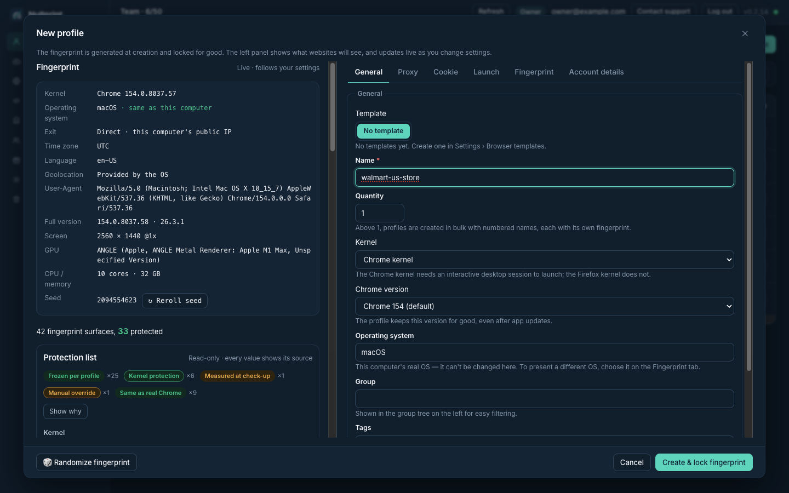

### Nullprint

**Nullprint AI Antidetect Browser** for e-commerce and social media teams. AI agents can operate real browser profiles through MCP.

- Frozen per-profile fingerprints on a custom Chromium kernel
- Time zone, language and geolocation follow each profile's proxy
- Local API + MCP server (18 tools) so AI agents can create, check and drive profiles

**What's new (0.2.17):** closing a window no longer loses sign-ins; steadier cloud sync. [Changelog](https://nullprint.ai/changelog/)

**New guide:** drive Nullprint from DeepSeek's dsh agent over MCP. [Docs](https://nullprint.ai/docs/mcp/dsh/)

**Video tutorial (4 min):** set up two profiles, one on a US IP and one on a Japan IP, fully separate. [Watch on YouTube](https://youtu.be/0IvP3Pv9ZA0) · [All tutorials](https://nullprint.ai/tutorials/)

**Repos:** [nullprint-mcp](https://github.com/nullprintai/nullprint-mcp) (Python on PyPI, Node on npm)

**Docs:** [nullprint.ai/docs](https://nullprint.ai/docs/) · **Free plan**, Windows & macOS
